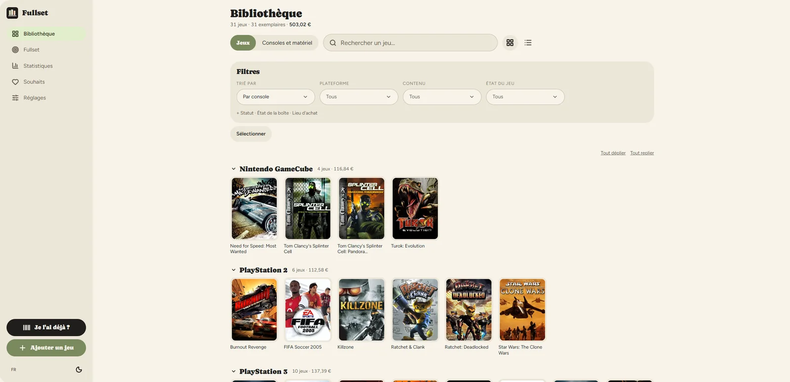
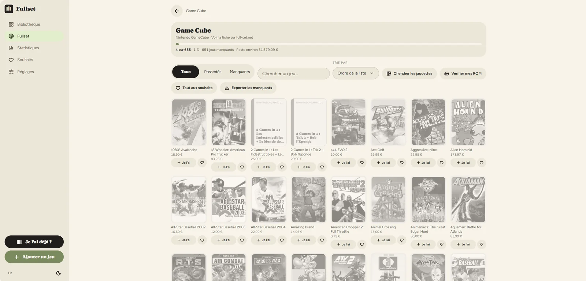
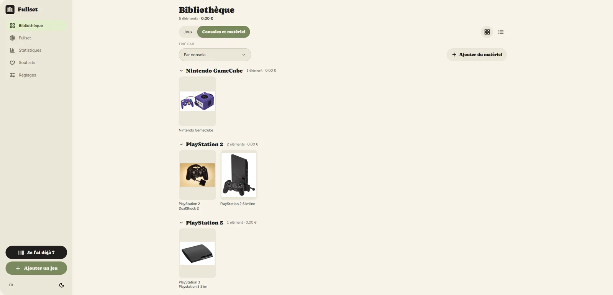
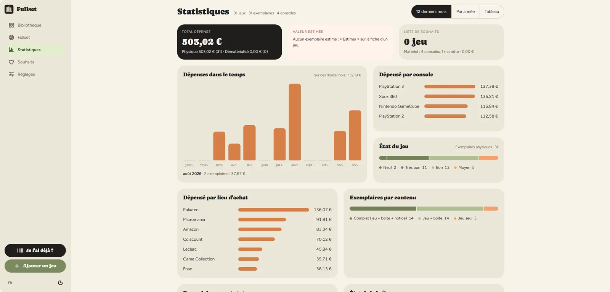
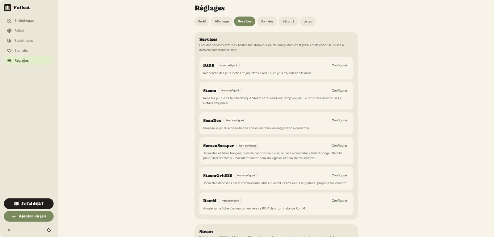
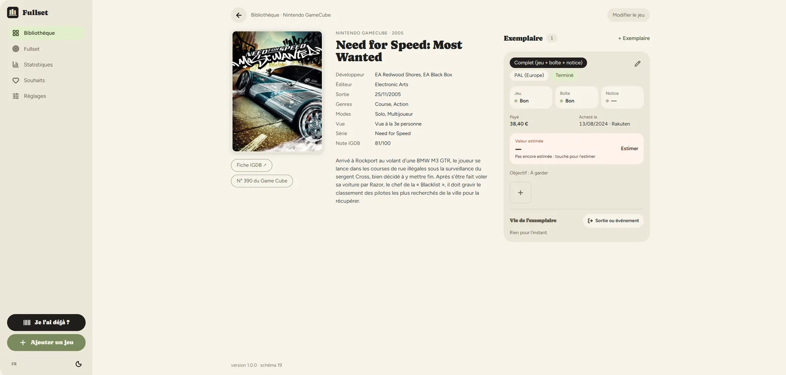
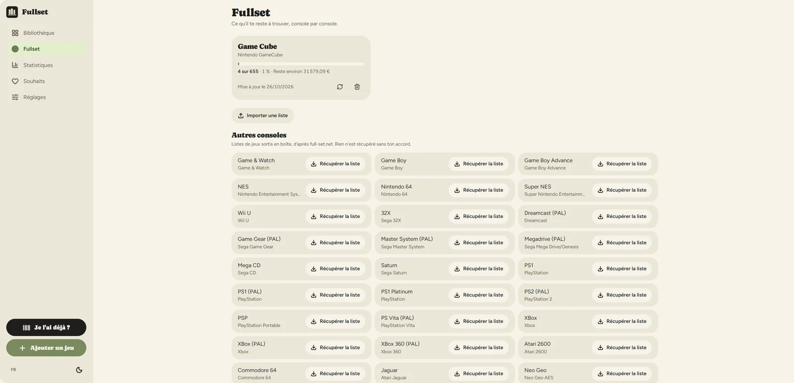

# Fullset

Self-hosted inventory for your video game collection: physical and digital copies, condition of the game, box and manual, what you paid, what it is worth, plus your consoles and accessories. Built for collectors, phone first.

> The interface is available in **English and French**. [Version française plus bas.](#français)



## What it does

**Your collection, copy by copy.** A game is one thing, the copy you own is another: Fullset tracks each copy with its support, region, edition, content, three separate conditions (game, box, manual), purchase price, date and place, your own notes and photos. Two copies of the same game stay two copies.

**Add a game in seconds.** Search IGDB (European titles and covers included), or scan the barcode on the box. Fullset remembers the barcodes you scan, so the second time it knows the game.

**Covers, from several sources.** IGDB, ScreenScraper (localised titles) and SteamGridDB can all be connected; you pick the cover you want from what they propose. A game can also use a photo of your own box.

**Know what is missing: the Fullset mode.** Load the reference list of everything released on a console, and see your collection against it — like a pokédex. What you own, what is missing, and roughly what it would cost. Missing games can go to your wishlist in one click, or leave as a CSV for a flea market.



**The life of a copy.** Sold, given, traded, lent to someone, lost, broken: a copy leaves the collection with a reason and a date, without being erased. Its journal stays on the game page, loans in progress are listed, and the statistics tell you what you got back compared to what you paid.

**Consoles and accessories** are tracked too, with their own conditions and a reference picture from Wikimedia Commons when you have no photo.



**Statistics** on what you spent, by console, by place, by month or by year, the state of your collection, and the estimated value you record yourself, with its history.



**Made for the field.** It installs as an app on your phone (PWA) and keeps browsing when the network is gone — useful in a flea market, with the barcode scanner and the "do I already own it?" check.

**Your data stays yours.** Full export in CSV and JSON, a complete backup as a single `.zip` (database, covers and photos), and its restore. No account anywhere else, no telemetry.

## Requirements

| | |
|---|---|
| **Docker** | with the Compose plugin (`docker compose version`) |
| **Port** | 3110 by default, change it with `FULLSET_PORT` |
| **Disk** | ~450 MB for the image, plus your data: a few MB per hundred games (covers and photos) |
| **Memory** | around 150 MB at rest — a Raspberry Pi is enough (amd64 and arm64 images are published) |
| **HTTPS** | only needed for the barcode scanner, which browsers reserve to secure pages |

Nothing else: the database is a SQLite file, inside the container's `/data`.

## Install

```sh
git clone https://github.com/carculture-fr/Fullset.git && cd Fullset
docker compose up -d
```

Then open `http://<your-server>:3110` and create your account. There is **one account per installation**, and sign-up closes for good once it exists.

To use another port, create a `.env` file next to `compose.yaml`:

```sh
echo "FULLSET_PORT=8080" > .env && docker compose up -d
```

### Install with an AI agent

If you use Claude Code or a similar agent, ask it:

> "Install Fullset on this server, following AGENTS.md in the repository."

[AGENTS.md](AGENTS.md) tells it what to check first, what to ask you, what **not** to do (create your account, invent a password, put keys in `compose.yaml`) and how to verify the install is healthy.

### Optional services

Everything works without them — games can always be added by hand. Set them during the first-run wizard or later in *Settings → Services*, each with a *Test* button. Keys are stored in the database and never sent back to the browser (only their last 4 characters are shown). Environment variables, if set (see [`.env.example`](.env.example)), take precedence and become read-only in the app.

| Service | What it brings | Where to get it |
|---|---|---|
| **IGDB** | game search, metadata and covers | free Twitch developer account |
| **ScreenScraper** | covers and localised titles, console by console | free account **and** developer credentials (asked on their forum, free software only) |
| **SteamGridDB** | community covers, when the others have none | free key in your profile preferences |
| **Steam** | links your PC games and brings back play time | Steam Web API key + SteamID64 |
| **ScanDex** | suggests the game behind a barcode you don't know yet | token on their site |
| **RomM** | a link from a game to its ROM in your [RomM](https://github.com/rommapp/romm) | your instance address and an API token |



### Behind a reverse proxy

The barcode scanner needs the camera, which browsers only allow over HTTPS. Put Fullset behind your usual reverse proxy and set `TRUST_PROXY` to the proxy address, so login rate limits see the real client IP. If your proxy does not forward `X-Forwarded-Host`, also set `ALLOWED_ORIGINS` to the public address, otherwise writes are refused.

### Backup

All the state lives in `/data` (SQLite database, covers, photos), kept in the `fullset-data` volume: back it up like the rest of your server. You can also replace that volume by a path you already back up.

From the app, *Settings → Data* offers a **full backup** as a single `.zip` — the JSON export plus every cover and photo — and puts it back with **Restore a backup**. Restoring replaces the current collection (games, hardware, wishlist, images), so it asks for confirmation. Reference lists and service keys are left untouched.

## Commands

| | |
|---|---|
| Start / update | `docker compose up -d` |
| Logs | `docker compose logs -f` |
| Forgot your password | `docker exec fullset node server/dist/cli/reset-password.js` |
| Import a starting collection | `docker exec fullset node server/dist/cli/import-collection.js /data/import/collection.json` |
| Demo data | `python3 scripts/demo.py http://localhost:3110 <user> <password>` |

The import refuses to run on a collection that is not empty; `--covers-only` retries missing covers.

## Development

Node 22. `npm install`, then:

| | |
|---|---|
| `npm run dev` | API on :3110, Vite on :5176 |
| `npm test` | server and web tests |
| `npm run typecheck` | TypeScript, both sides |
| `npm run build` | `server/dist` and `web/dist` |

The interface is in English and French (`web/src/locales/`, `server/src/locales/`; French is the reference). Values are stored in French and translated on screen.

## Security

Please report vulnerabilities privately: see [SECURITY.md](SECURITY.md).

## License

[AGPL-3.0](LICENSE). Game data comes from [IGDB](https://www.igdb.com), console pictures from [Wikimedia Commons](https://commons.wikimedia.org) (credited in the app), and the console list was built from IGDB and [RomM](https://github.com/rommapp/romm). Reference lists in the Fullset mode are fetched on demand from their source, which is always named on screen.

---

## Français

Inventaire auto-hébergé de ta collection de jeux vidéo : exemplaires physiques et dématérialisés, état du jeu, de la boîte et de la notice, prix payé, valeur estimée, plus tes consoles et accessoires. Pensé pour les collectionneurs, d'abord sur téléphone.

## Ce que ça fait

**Ta collection, exemplaire par exemplaire.** Un jeu est une chose, l'exemplaire que tu possèdes en est une autre : Fullset suit chaque exemplaire avec son support, sa région, son édition, son contenu, ses trois états distincts (jeu, boîte, notice), son prix d'achat, sa date, son lieu, tes notes et tes photos. Deux exemplaires du même jeu restent deux exemplaires.

**Ajouter un jeu en quelques secondes.** Cherche dans IGDB (titres et jaquettes européens compris), ou scanne le code-barres de la boîte. Fullset retient les codes que tu scannes : la deuxième fois, il connaît le jeu.

**Les jaquettes, depuis plusieurs sources.** IGDB, ScreenScraper (titres français) et SteamGridDB se branchent chacun avec tes identifiants ; tu choisis la jaquette parmi ce qu'ils proposent. Une photo de ta propre boîte fait aussi l'affaire.



**Savoir ce qui manque : le mode Fullset.** Charge la liste de référence de tout ce qui est sorti sur une console, et vois ta collection en face — comme un pokédex. Ce que tu as, ce qui manque, et à peu près ce qu'il reste à dépenser. Les manquants partent dans tes souhaits d'un geste, ou dans un CSV à emporter en brocante.



**La vie d'un exemplaire.** Vendu, donné, échangé, prêté à quelqu'un, perdu, hors service : un exemplaire sort de la collection avec un motif et une date, sans être effacé. Son journal reste sur la fiche du jeu, les prêts en cours sont listés, et les statistiques disent ce que tu as récupéré par rapport à ce que tu avais payé.

**Les consoles et accessoires** sont suivis aussi, avec leurs états et une image de référence de Wikimedia Commons tant que tu n'as pas de photo.

**Des statistiques** sur ce que tu as dépensé, par console, par lieu, par mois ou par année, l'état de ta collection, et la valeur estimée que tu saisis toi-même, avec son historique.

**Fait pour le terrain.** L'appli s'installe sur le téléphone (PWA) et continue de s'afficher sans réseau — utile en brocante, avec le lecteur de codes-barres et la question « est-ce que je l'ai déjà ? ».

**Tes données restent les tiennes.** Export complet en CSV et JSON, sauvegarde complète en un seul `.zip` (base, jaquettes et photos) et sa restauration. Aucun compte ailleurs, aucune télémétrie.

## Ce qu'il faut

| | |
|---|---|
| **Docker** | avec le greffon Compose (`docker compose version`) |
| **Un port** | 3110 par défaut, modifiable par `FULLSET_PORT` |
| **Du disque** | ~450 Mo pour l'image, plus tes données : quelques Mo par centaine de jeux |
| **De la mémoire** | environ 150 Mo au repos — un Raspberry Pi suffit (images amd64 et arm64) |
| **HTTPS** | seulement pour le lecteur de codes-barres, que les navigateurs réservent aux pages sécurisées |

Rien d'autre : la base est un fichier SQLite, dans `/data` à l'intérieur du conteneur.

## Installation

```sh
git clone https://github.com/carculture-fr/Fullset.git && cd Fullset
docker compose up -d
```

Ouvre ensuite `http://<ton-serveur>:3110` et crée ton compte. Il y a **un seul compte par installation**, et l'inscription se ferme définitivement une fois qu'il existe.

Pour un autre port, crée un fichier `.env` à côté de `compose.yaml` :

```sh
echo "FULLSET_PORT=8080" > .env && docker compose up -d
```

### Installer avec un agent IA

Si tu utilises Claude Code ou un agent équivalent, demande-lui :

> « Installe Fullset sur ce serveur, en suivant AGENTS.md du dépôt. »

[AGENTS.md](AGENTS.md) lui dit quoi vérifier d'abord, quoi te demander, ce qu'il ne doit **pas** faire (créer ton compte, inventer un mot de passe, mettre des clés dans `compose.yaml`) et comment vérifier que l'installation est saine.

### Services facultatifs

Tout fonctionne sans eux — un jeu s'ajoute toujours à la main. Ils se règlent à l'installation ou dans *Réglages → Services*, chacun avec un bouton *Tester*. Les clés sont gardées en base et ne repartent jamais vers le navigateur (seuls leurs 4 derniers caractères s'affichent). Les variables d'environnement, si elles existent (voir [`.env.example`](.env.example)), passent devant et deviennent non modifiables dans l'appli.

| Service | Ce qu'il apporte | Où l'obtenir |
|---|---|---|
| **IGDB** | recherche des jeux, fiches et jaquettes | compte développeur Twitch gratuit |
| **ScreenScraper** | jaquettes et titres français, console par console | compte gratuit **et** identifiants développeur (demandés sur leur forum, logiciels gratuits seulement) |
| **SteamGridDB** | jaquettes de la communauté, quand les autres n'ont rien | clé gratuite dans les préférences du profil |
| **Steam** | relie tes jeux PC et reprend leur temps de jeu | clé API Steam + SteamID64 |
| **ScanDex** | propose le jeu derrière un code-barres inconnu | jeton sur leur site |
| **RomM** | un lien d'un jeu vers sa ROM dans ton [RomM](https://github.com/rommapp/romm) | l'adresse de ton instance et un jeton d'API |

### Derrière un proxy inverse

Le lecteur de codes-barres a besoin de la caméra, que les navigateurs n'autorisent qu'en HTTPS. Place Fullset derrière ton proxy inverse habituel et pose `TRUST_PROXY` à l'adresse du proxy, pour que les limites d'essais de connexion voient la vraie adresse du client. Si ton proxy ne transmet pas `X-Forwarded-Host`, pose aussi `ALLOWED_ORIGINS` à l'adresse publique, sinon les écritures sont refusées.

### Sauvegarde

Tout l'état vit dans `/data` (base SQLite, jaquettes, photos), gardé dans le volume `fullset-data` : sauvegarde-le comme le reste de ton serveur. Tu peux aussi remplacer ce volume par un dossier que tu sauvegardes déjà.

Depuis l'appli, *Réglages → Données* propose une **sauvegarde complète** en un seul `.zip` — l'export JSON, toutes les jaquettes et toutes les photos — et sait la remettre en place avec **Restaurer une sauvegarde**. La restauration remplace la collection en cours (jeux, matériel, souhaits, images), d'où la confirmation demandée. Les listes de référence et les clés des services ne sont pas touchées.

## Commandes

| | |
|---|---|
| Démarrer / mettre à jour | `docker compose up -d` |
| Journaux | `docker compose logs -f` |
| Mot de passe oublié | `docker exec fullset node server/dist/cli/reset-password.js` |
| Importer une collection de départ | `docker exec fullset node server/dist/cli/import-collection.js /data/import/collection.json` |
| Données de démonstration | `python3 scripts/demo.py http://localhost:3110 <identifiant> <mot-de-passe>` |

L'import refuse de s'exécuter sur une collection qui n'est pas vide ; `--covers-only` retente les jaquettes manquantes.

## Développement

Node 22. `npm install`, puis :

| | |
|---|---|
| `npm run dev` | API sur :3110, Vite sur :5176 |
| `npm test` | tests serveur et interface |
| `npm run typecheck` | TypeScript, des deux côtés |
| `npm run build` | `server/dist` et `web/dist` |

L'interface existe en français et en anglais (`web/src/locales/`, `server/src/locales/` ; le français fait référence). Les valeurs sont stockées en français et traduites à l'affichage.

## Sécurité

Signale une vulnérabilité en privé : voir [SECURITY.md](SECURITY.md).

## Licence

[AGPL-3.0](LICENSE). Les données des jeux viennent d'[IGDB](https://www.igdb.com), les photos de consoles de [Wikimedia Commons](https://commons.wikimedia.org) (créditées dans l'appli), et le catalogue des consoles a été constitué à partir d'IGDB et de [RomM](https://github.com/rommapp/romm). Les listes de référence du mode Fullset sont récupérées à la demande chez leur source, toujours nommée à l'écran.
